# Subtomogram averaging benchmarks on EMPIAR-10164 and EMPIAR-10491

This repository reports the results of processing two public cryo-electron tomography datasets with
RELION 5 and with WarpTools, RELION 5 and M, and compares them with the results published in the
official tutorials for those programs. The HIV-1 dataset (EMPIAR-10164) was processed with the RELION 5
subtomogram averaging tutorial workflow. The apoferritin dataset (EMPIAR-10491) was processed three
ways: with the WarpTools tutorial on the same five tilt series the tutorial uses, with RELION 5 on all 37
tilt series, and with WarpTools, RELION 5 and M on all 37 tilt series. The repository contains the
resolution estimates, the Fourier shell correlation (FSC) curves as tables and figures, run times, map
images and the processing parameters. The maps and half maps are provided as release files (see
[Data availability](#data-availability)). The processing scripts are not included.

## Purpose

### Why this processing was done

The processing reported here had three aims: to learn the subtomogram averaging workflows of RELION 5
and of WarpTools and M, to become familiar with the programs these workflows use, and to validate the
workflows on the software versions and computing infrastructure available at the New York Structural
Biology Center (NYSBC) as of October 2026. All processing was done between 8 and 21 October 2026, with
the software versions listed under [Methods and parameters](#methods-and-parameters). The two datasets
are those of the official tutorials, whose published results serve as a reference against which each
stage of the processing can be checked.

### Why it is shared publicly

The results are published so that others can review them and point out any problems they find. Issues
and corrections can be raised through the issue tracker of this repository. The run times may also be
useful in their own right: to the author's knowledge, run times for the same data processed with
different programs and parameters are not easy to find in public sources. This repository reports them
for each processing step, together with the hardware that was used.

## Results

| Row | Dataset | Workflow | Data used | Particles | Final box, pixel size | Symmetry | Resolution at FSC 0.143 | B-factor (Ų) | Reference value | GPUs | Run time |
|---|---|---|---|---|---|---|---|---|---|---|---|
| A | EMPIAR-10164, HIV-1 CA-SP1 | RELION 5.0.1, tutorial workflow | the tutorial's 5 tilt series | 9,125 | 192 px, 1.35 Å | C6 | 3.323077 Å (relion_postprocess) | −77.31857 | 3.3 Å, RELION 5 tutorial [1] | NVIDIA L40S, up to 2 | 43 h 36 min (49.4 GPU h) |
| B | EMPIAR-10491, apoferritin | WarpTools, RELION 5.0.1 and M, tutorial workflow | the tutorial's 5 tilt series | 1,706 | 330 px, 0.7894 Å | O | 2.76 Å (M; 2.771298 Å as the last shell at or above 0.143); 2.771298 Å (relion_postprocess with the mask of rows C and D) | −32.03463 (relion_postprocess) | 2.9 Å, WarpTools tutorial [2] | NVIDIA L40S, 1 | 5 h 09 min (5.2 GPU h) |
| C | EMPIAR-10491, apoferritin | RELION 5.0.1 | all 37 tilt series | 25,352 | 256 px, 0.834 Å | O | 2.635852 Å (relion_postprocess) | −76.55255 | none (no RELION tutorial for this dataset) | NVIDIA L40S, up to 2 (template matching up to 4) | 98 h 08 min (117.0 GPU h, without template matching) |
| D | EMPIAR-10491, apoferritin | WarpTools, RELION 5.0.1 and M | all 37 tilt series | 25,838 | 256 px, 0.834 Å | O | 2.511812 Å (relion_postprocess with the mask of row C) | −52.33684 | row C, same mask and post-processing | NVIDIA L40S, up to 2 | 11 h 10 min (20.8 GPU h) |

Resolutions are given exactly as the programs wrote them. RELION reports the last Fourier shell at
which the corrected FSC is at or above 0.143, so its values fall on the shells of the box. M reports a
value interpolated between shells; for row B the shell value is given as well, for comparison with the
RELION rows. Further notes on how far these numbers can be compared are in [Caveats](#caveats).

Rows A and B are the comparisons with the tutorials. Row A reaches 3.323077 Å, which reproduces the 3.3 Å
the RELION tutorial reports after five refinement cycles.
Row B reaches 2.76 Å where the WarpTools tutorial reports 2.9 Å, with the same five tilt series and the
same nominal pixel size, but possibly with a different build of WarpTools and M (the tutorial page does
not state its build; see Caveats). Rows C and D compare the two workflows on the full dataset, with the same mask and the
same post-processing for both maps. Row D is not a tutorial comparison, because it uses all 37 tilt
series where the WarpTools tutorial uses five. The three apoferritin maps (rows B, C and D) were all
post-processed by `relion_postprocess` with the same mask. Row B's map uses the same detector pixel as
the other two (labelled 0.7894 Å rather than 0.834 Å; see Caveats), so the mask, padded from 256 to 330
voxels, fits it voxel for voxel.

## FSC curves

Each figure shows the four curves that RELION's post-processing writes: the corrected curve, from
which the resolution is read, the curve between the masked half maps, the curve between the unmasked
half maps, and the curve between masked half maps whose phases were randomised beyond a set
resolution, which measures how much the mask itself adds to the correlation. The x axis is linear in
spatial frequency; its labels give the resolution in Å. The tutorials do not publish their FSC curves, so the tutorial
values are marked as vertical dashed lines instead. The tables behind each figure are in `data/`.

**Row A, HIV-1 CA-SP1, RELION 5 tutorial workflow.** The corrected FSC crosses 0.143 at 3.323077 Å by
RELION's rule (3.2874 Å if interpolated between shells), next to the tutorial's 3.3 Å.

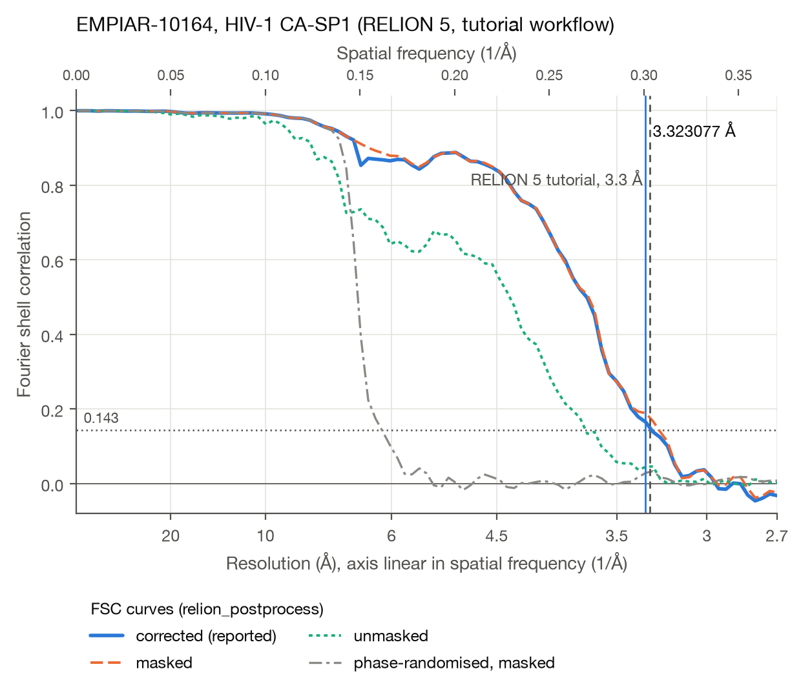

**Row B, apoferritin, WarpTools, RELION 5 and M on the tutorial's five tilt series.** These curves are
M's own FSC calculation, the same calculation the WarpTools tutorial reports. The resolution after each M
step, next to the tutorial's value for the same step, is in `data/m_ladder_B.csv` and in the processing
diagram below. The masked and corrected curves
coincide because the phase-randomised curve is close to zero at every frequency beyond the point where
the randomisation begins.

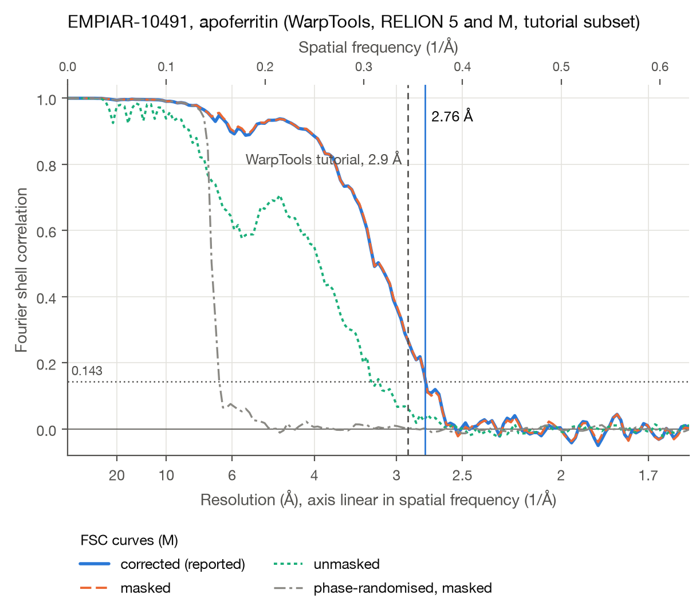

The same half maps were also post-processed with `relion_postprocess`, first with the mask file that M
wrote for this map and then with the mask of rows C and D (padded from 256 to 330 voxels). With the mask
of rows C and D, RELION's corrected curve lies on M's and gives 2.771298 Å, the same shell M's curve
crosses. With M's mask file, RELION gives 2.631333 Å, but this is likely to be optimistic: its corrected
curve keeps a tail near 0.12 beyond 2.6 Å, and RELION's estimate of the protein mass inside that mask is
354 kDa at row B's 0.7894 Å/px (about 417 kDa at 0.834 Å/px), less than the mass of the apoferritin
24-mer (about 509 kDa), against 868 kDa (about 1,024 kDa) for the mask of rows C and D. The unmasked
curves of the two programs agree to within 0.03, which confirms that all three calculations use the same
half maps. The table reports the value with the mask of rows C and D.

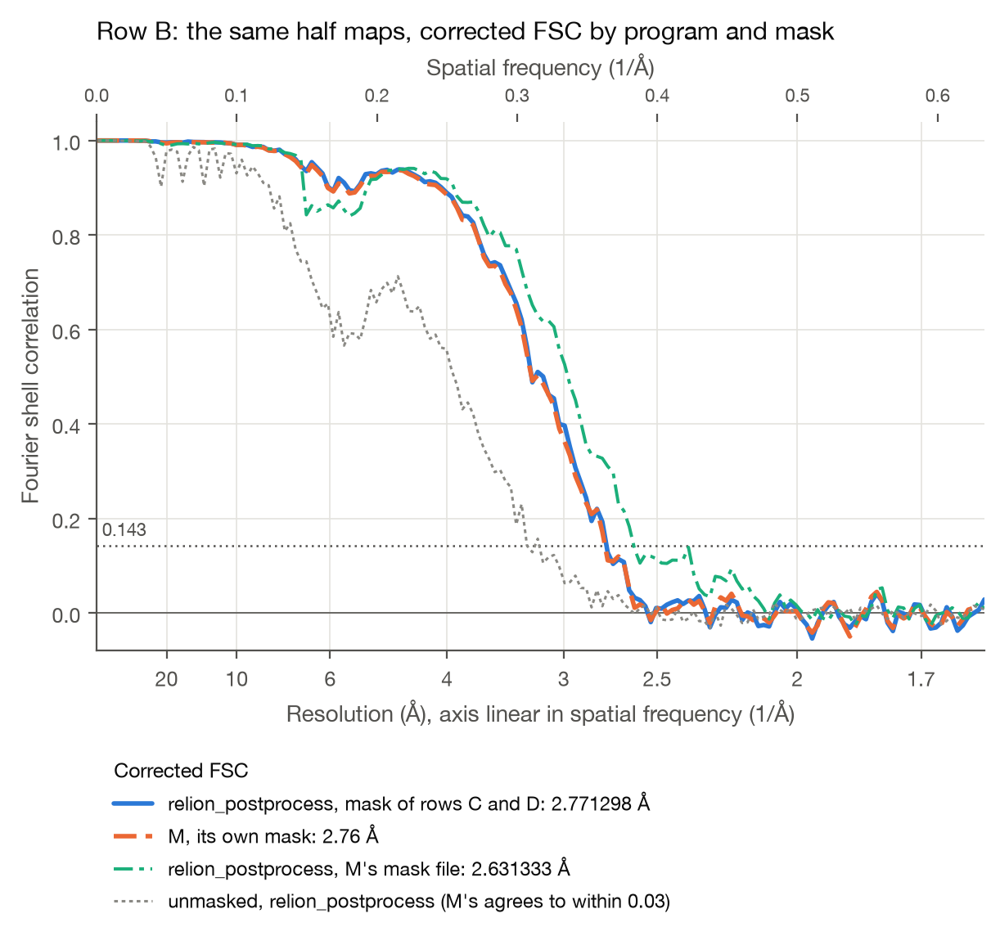

**Row C, apoferritin, RELION 5 on all 37 tilt series.**

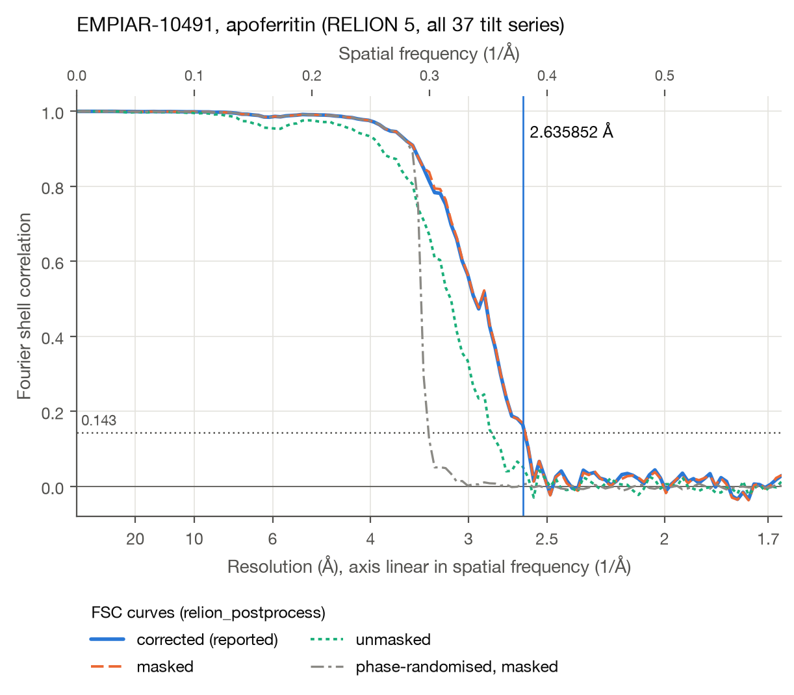

**Row D, apoferritin, WarpTools, RELION 5 and M on all 37 tilt series**, post-processed with the mask
and settings of row C.

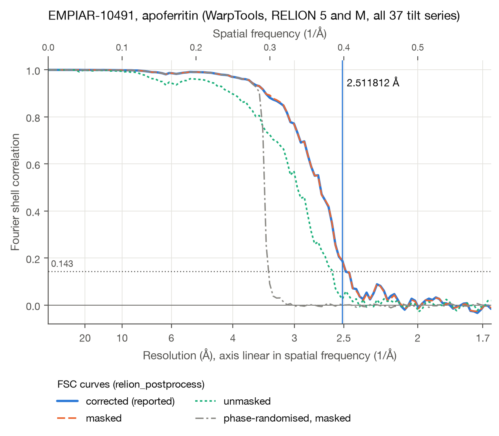

**Rows C and D compared.** The corrected FSC of the two maps on one plot. Both were computed by
`relion_postprocess` with the same mask and settings, on maps with the same box and pixel size.

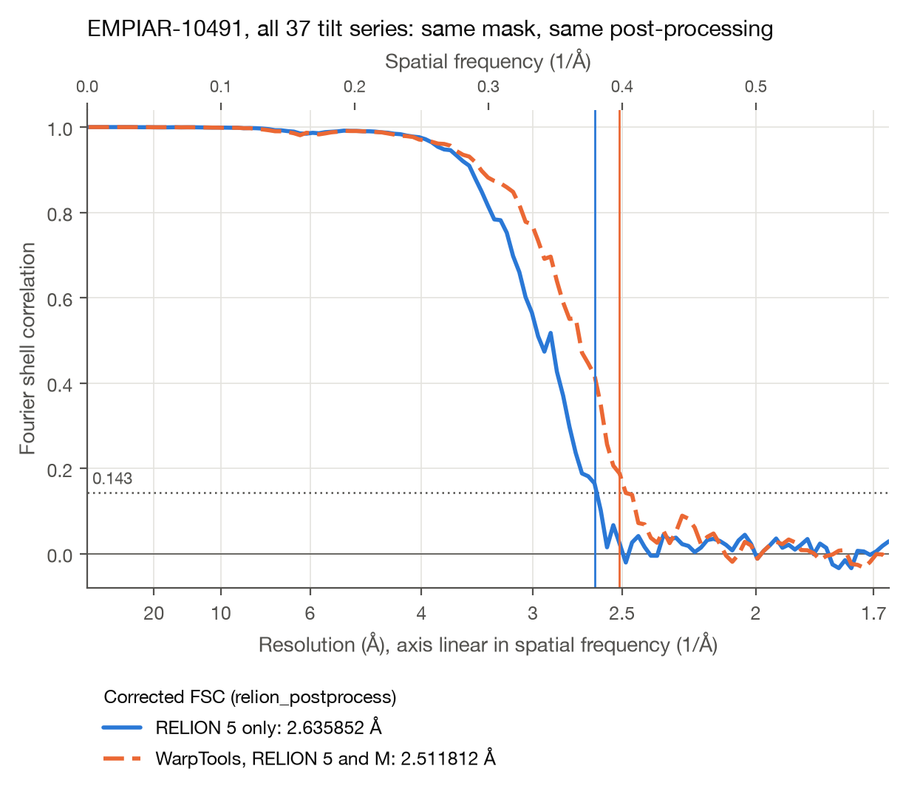

The resolution of row D improved over the course of the M refinement. The table below gives the value
after each M step, both from M's own FSC and from `relion_postprocess` with the mask of row C
(`data/m_ladder_D.csv`).

| M step | Refinement added | Run time, 2 GPUs | M's FSC (Å) | relion_postprocess (Å) | B-factor (Ų) |
|---|---|---|---|---|---|
| 0 | none (reconstruction from the RELION poses) | 9 min 54 s | 4.07 | 3.745684 | −104.36290 |
| 1 | image warp, particle poses, defocus (exhaustive search) | 16 min 30 s | 3.73 | 3.745684 | −104.43882 |
| 2 | image warp, particle poses, defocus | 40 min 21 s | 2.94 | 2.924712 | −76.19305 |
| 3 | as step 2, plus stage angles | 13 min 41 s | 2.82 | 2.846720 | −65.27684 |
| 4 | as step 3, plus magnification, spherical aberration and third-order Zernike terms | 1 h 59 min 36 s | 2.61 | 2.635852 | −54.10240 |
| 5 | per-tilt-series weights | 12 min 37 s | 2.59 | 2.603707 | −53.12663 |
| 6 | per-tilt weights, particle poses | 27 min 21 s | 2.56 | 2.511812 | −52.66702 |
| 7 | temporal pose model with two samples, with all refinements of step 4 | 2 h 24 min 42 s | 2.47 | 2.511812 | −52.33684 |

## Map images

The map of row A is shown below as the CA-SP1 lattice around one hexamer, with the central hexamer
coloured by domain where it lies within 4 Å of PDB 5L93 [12] fitted as a rigid body, and as a mesh
close-up of the helix that spans the CA-SP1 junction. Contour levels are given in standard deviations
above the mean of the map.

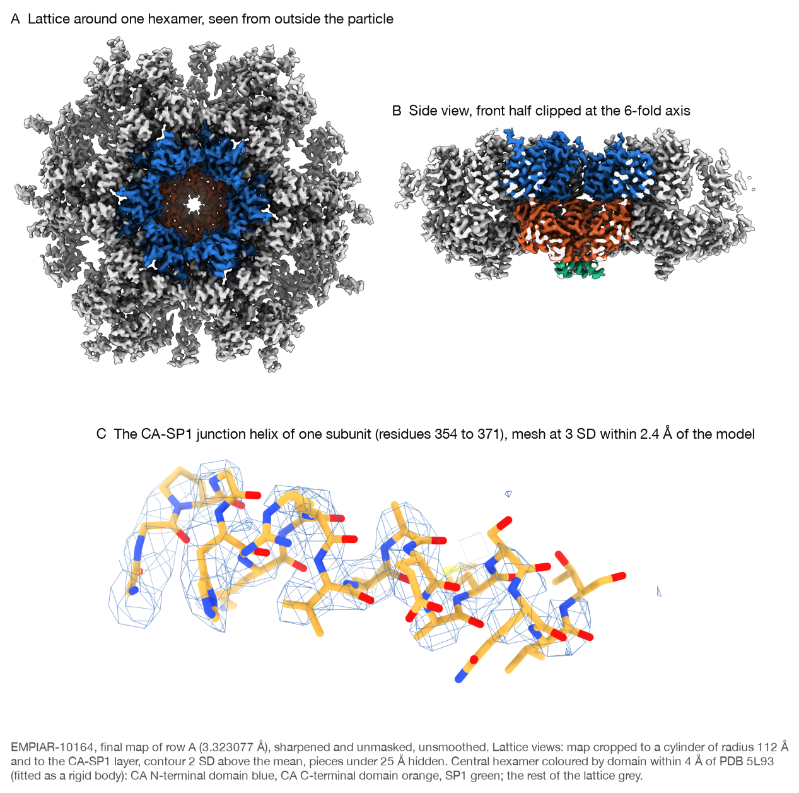

The maps of rows C and D are shown at the same contour rule (4 standard deviations above the mean of the
whole map for the cage, 5 for the mesh), viewed down a 4-fold axis, with one helix of chain A and the
atomic model PDB 7A6A [13] fitted as a rigid body. The two maps share the box, the pixel size and the
mask, but not the intensity scale, which is why the contour is given in standard deviations rather than
in absolute units.

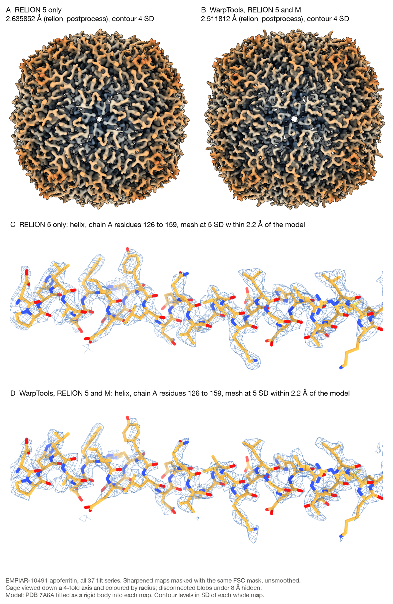

As further checks of the maps, PDB 7A6A fitted into the map of row C with a correlation of 0.80 (ChimeraX
fitmap correlation, not about the mean, with a map simulated from the model at 3 Å), and ModelAngelo [11]
built six CA-SP1 chains into the map of row A, 208 to 215 of 224 residues each (only the cyclophilin
A-binding loop is missing), within 0.9 Å Cα RMSD of PDB 5L93 [12] without further superposition (5L93
was placed by its rigid-body fit). PDB 5L93 was built from the same
EMPIAR-10164 data, so this second check tests the processing rather than the sample.

## Run time

The figure below gives the run time of each workflow from import to final map, divided into the stages of
the processing diagrams. Run times exclude time spent waiting in the queue and count the jobs on the main
line of the processing diagrams, in their final, successful run. GPU hours are the number of allocated GPUs
multiplied by run time. All GPU work ran on NVIDIA L40S cards.

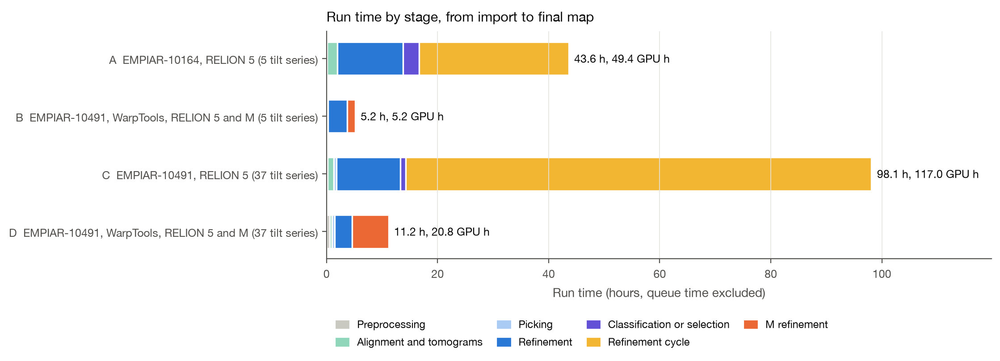

**How the times were measured.** For the two RELION projects (rows A and C), the run time of each job is
the interval between the moment the cluster job started RELION, recorded by a launch script that the
queue template writes just before RELION starts, and the exit marker that RELION writes when the job
ends. Jobs run outside the queue start at the time RELION recorded in the job's note file. These values
agree to within about a minute with the Slurm accounting records taken at the time of processing.
Interactive steps (excluding tilt images, picking spheres, selecting classes) are not timed. The template
matching of row C ran outside RELION, with pytom-match-pick, as an array of 37 tasks on up to four GPUs
at a time; its 26 minutes are the wall time of the array, and they are not included in the GPU hours.
For rows B and D the times come from Slurm accounting for the RELION and M jobs and from the logs of the
WarpTools steps. The values per job are in `data/runtime_jobs_A.csv` and `data/runtime_jobs_C.csv`, and
the values per step for all rows in `data/runtime_<row>.csv`.

**The same data processed two ways.** Rows C and D processed the same 37 tilt series. Row C took
98 h 08 min of run time (117.0 GPU hours) and reached 2.635852 Å. Row D took 11 h 10 min (20.8 GPU
hours) and reached 2.511812 Å with the same mask and post-processing. Most of the time of row C went into
the five refinement cycles (83 h 53 min), each of which ran CTF refinement, Bayesian polishing,
re-extraction, reconstruction and a 3D refinement at the full pixel size. Most of the time of row D went
into M (6 h 31 min). This compares two complete processing runs with the settings that were chosen for
them; it is not a measurement of the speed of the programs in general (see [Caveats](#caveats)).

Run time per step for each row

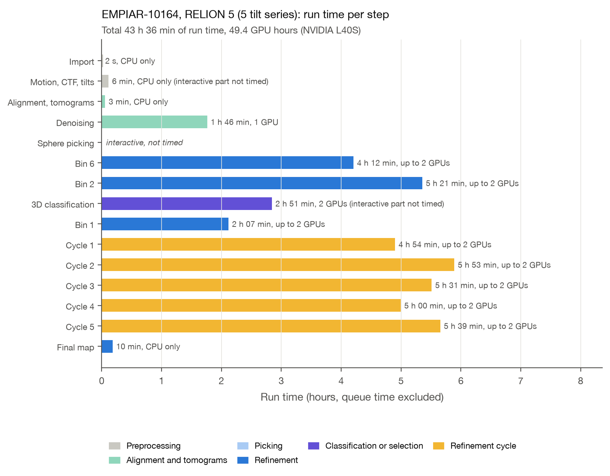

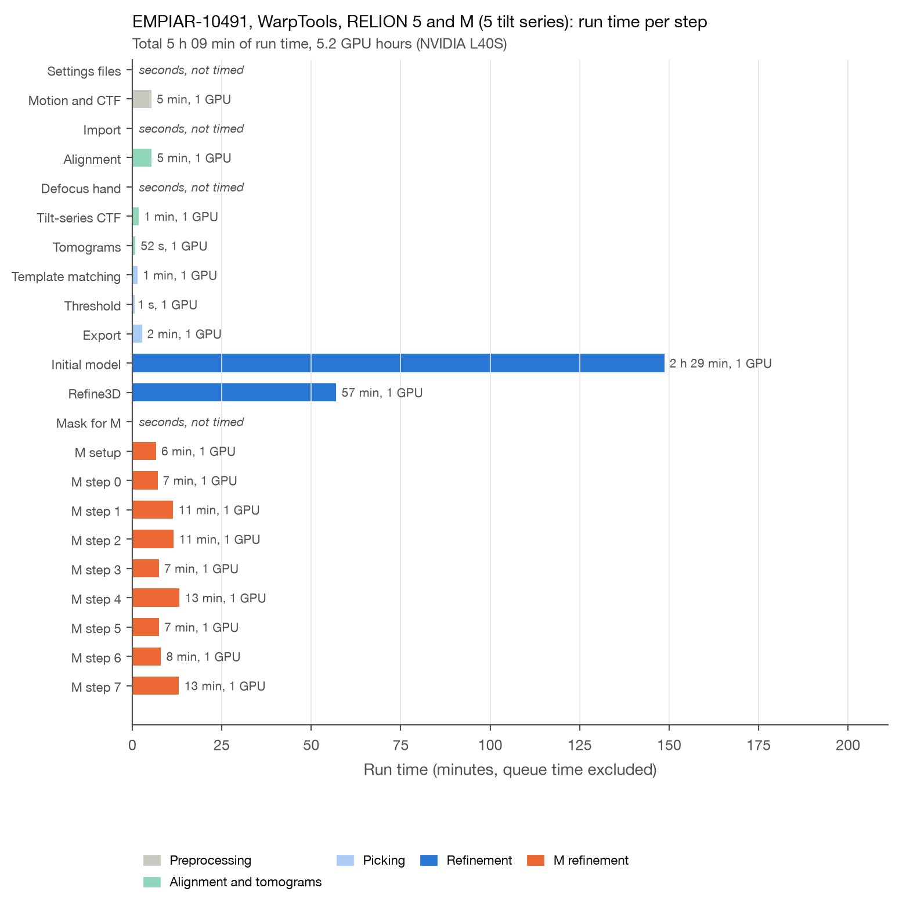

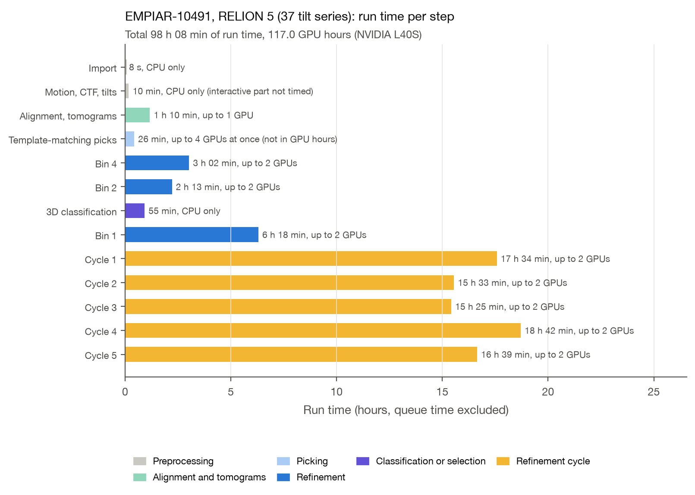

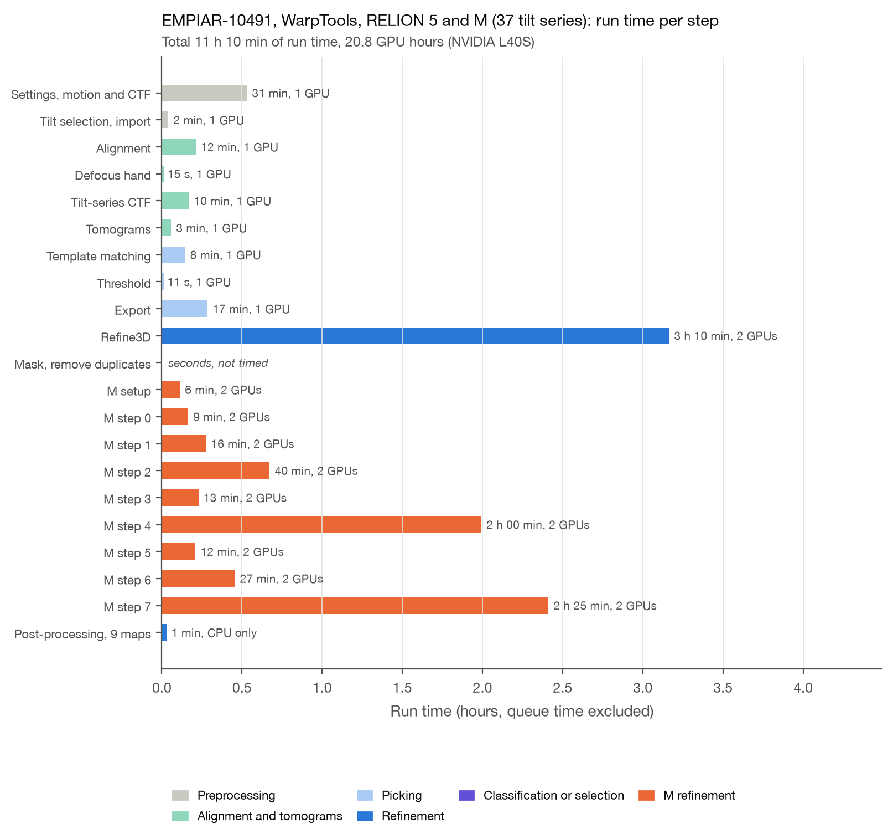

## Processing steps

The diagrams below show the processing as lines of job groups. Each pill is a group of jobs of one kind,
and the number above it is the resolution (or the number of particles kept) at the end of that stage,
with the tutorial's value in grey where the tutorial states one. Jobs that did not lead to the final map
(a superseded and a failed import, a stopped denoising run, checks, a side study and model building)
branch off below the line. For
the two RELION projects the groups were checked against the projects' own pipeline records: every job
belongs to exactly one group, and the job list with each job's type, status and parent jobs is in
`data/jobs_A.csv` and `data/jobs_C.csv`.

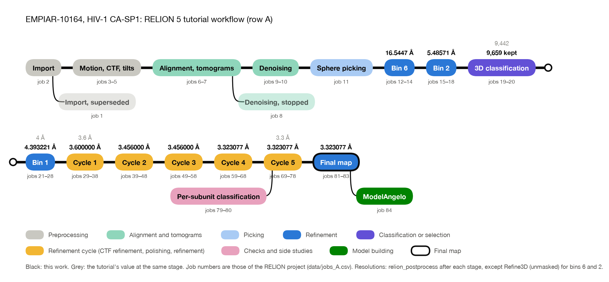

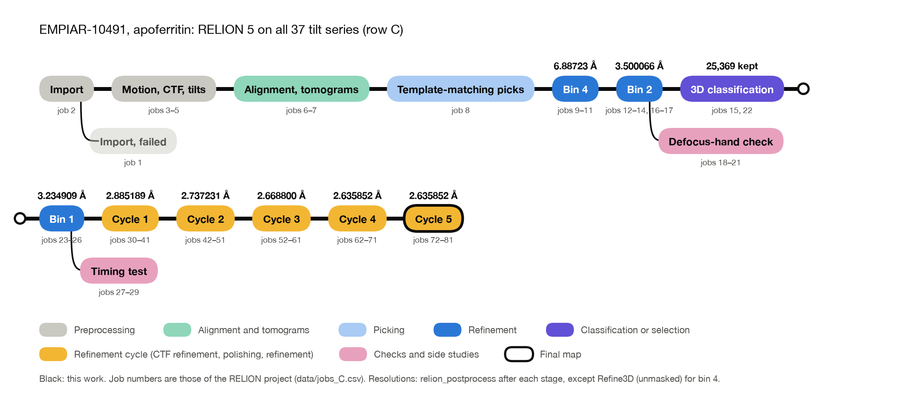

WarpTools and M do not keep a pipeline record of this kind, so the diagram for rows B and D lists their
steps directly. The WarpTools preprocessing steps were the same for both rows but were run separately on
the five and the 37 tilt series.

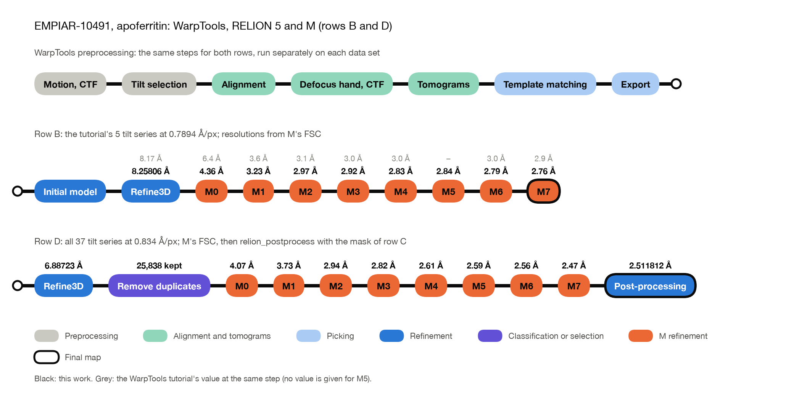

## Methods and parameters

| | Row A | Row B | Row C | Row D |
|---|---|---|---|---|
| Tilt series | TS_01, TS_03, TS_43, TS_45, TS_54 | TS_1, TS_11, TS_17, TS_23, TS_32 | all 37 | all 37 |
| Pixel size of the data | 0.675 Å (super-resolution), 1.35 Å after motion correction | 0.7894 Å (tutorial value) | 0.834 Å | 0.834 Å |
| Tilt-series alignment | IMOD, 10 nm fiducials | IMOD patch tracking (WarpTools) | AreTomo2 1.1.2 | IMOD patch tracking (WarpTools) |
| Picking | spheres on cryoCARE-denoised tomograms, 28,299 positions | WarpTools template matching | pytom-match-pick 0.13.0, template EMD-15854, 25,752 picks | WarpTools template matching (peak distance 80 Å), 28,037 picks |
| Particles in the final map | 9,125 | 1,706 | 25,352 | 25,838 |
| Reference for the first refinement | de novo, reconstructed from the picked positions | RELION initial model (de novo) | EMD-15854, low-pass filtered to 20 Å | EMD-15854, low-pass filtered to 20 Å |
| FSC mask | central hexamer, soft edge 8 px | M's species mask (M's FSC); the mask of rows C and D padded to 330 px (relion_postprocess, the reported value) | soft shell, extend 4 px, soft edge 12 px | the mask of row C |
| Sharpening | automatic B-factor, fit from 10 Å | M's filtering and sharpening; automatic B-factor, fit from 10 Å (relion_postprocess) | automatic B-factor, fit from 10 Å | automatic B-factor, fit from 10 Å |
| Refinement cycles | 5 (CTF refinement, polishing, refinement) | M steps 0 to 7 | 5 (CTF refinement, polishing, refinement) | M steps 0 to 7 |

Software versions: RELION 5.0.1 [5, 6], WarpTools and M 2.0.0dev41 [4, 7], IMOD 5.1.2 [8], AreTomo2
1.1.2 [9], pytom-match-pick 0.13.0 [10], cryoCARE 0.3.0 [14], CTFFIND 4.1.14 [15], ModelAngelo 1.0.13
[11], UCSF ChimeraX 1.12 [16] for the map images (with its bundled Python), and Python 3.14 with
matplotlib 3.11 and numpy 2.5 for the plots (exact versions in `uv.lock`).

## Caveats

- **Row D is not a tutorial comparison.** The WarpTools tutorial uses five tilt series. Row D uses all
  37 and about fifteen times as many particles. The like-for-like comparison with the tutorial is row B.
- **Nominal pixel size in row B.** The WarpTools tutorial uses 0.7894 Å/px. Fitting PDB 7A6A into the
  map of row C at a range of voxel sizes gives the best fit at about 0.829 Å/px, close to the 0.834 Å/px
  used for rows C and D, which suggests that 0.7894 Å/px is about 5 % too small. Row B kept the tutorial
  value so that it can be compared with the tutorial, so both are on the same compressed scale. On the
  0.834 Å/px scale, 2.76 Å corresponds to about 2.92 Å. The same fit suggests that the Å values of rows
  C and D may be about 0.6 % too large.
- **Software builds differ.** Row B used WarpTools and M 2.0.0dev41. The tutorial page does not state
  its build, and the resolution after M's first, refinement-free step differed (4.36 Å against the
  tutorial's 6.4 Å), so part of the difference in row B may come from the software rather than the
  processing.
- **Resolution is quantised by the box.** For row A (box 192 at 1.35 Å) the corrected FSC is 0.165 at
  the reported shell, 3.323077 Å, and 0.139 at the next one, 3.281013 Å, and the shells before it lie
  at 3.456000, 3.410526 and 3.366234 Å, so a small change in processing moves the reported value by
  one or two shells. Row A matches the tutorial's 3.3 Å and does not exceed it. The tutorial itself
  notes that 3.2 Å is possible.
- **Different FSC calculations.** M's own FSC and `relion_postprocess` give different numbers for the
  same half maps: for the final map of row D, 2.47 Å (M, interpolated between shells) and 2.511812 Å
  (RELION, with the mask of row C; 2.4831 Å if RELION's curve is interpolated as M does). For row B the
  two programs agree when RELION uses the mask of rows C and D: both curves cross 0.143 at the shell
  2.771298 Å, and M's interpolated value is 2.76 Å. With the mask file M wrote, which RELION applies as a
  tight mask, RELION gives 2.631333 Å (see the row B figures under FSC curves). For row B, the choice of
  mask changed the reported value more than the choice of program.
  Each value in this repository is labelled with the program and mask that produced it. Rows B, C and D
  were all post-processed by `relion_postprocess` with the same mask.
- **Particle numbers differ from the tutorials'.** Row A kept 9,659 particles after 3D classification,
  where the RELION tutorial reports 9,442 in its own workspace (3D classification page). Neither
  tutorial states its final particle count.
- **Run times come from a shared cluster and from particular settings.** They exclude queue time and
  include only the final, successful run of each step; earlier attempts, the stopped and superseded jobs
  and the side studies are not counted. The difference between rows C and D reflects the settings chosen
  as much as the programs: the number of refinement cycles, the box sizes, and the number of MPI
  processes, threads and GPUs per job all change the run time, several RELION jobs ran on CPU-only
  nodes, and row D benefited from decisions made during row C (pixel size, defocus handedness,
  reference and mask).

## Repository contents

| Path | Contents |
|---|---|
| `data/fsc_<row>.csv` | FSC curves: spatial frequency, resolution, corrected, unmasked, masked and phase-randomised masked FSC (`fsc_B.csv` by M; `fsc_Brelion.csv` and `fsc_BrelionMmask.csv` by relion_postprocess for the same half maps, with the mask of rows C and D and with M's mask file) |
| `data/fsc_summary.csv` | reported resolution and B-factor per row, with the last shell at or above 0.143 and the interpolated crossing recomputed from the tables |
| `data/m_ladder_B.csv`, `data/m_ladder_D.csv` | resolution and run time after each M step of rows B (with the tutorial's values) and D |
| `data/runtime_<row>.csv` | run time, GPUs and GPU time per step |
| `data/runtime_jobs_A.csv`, `data/runtime_jobs_C.csv` | run time, GPUs, MPI processes and threads of every RELION job |
| `data/jobs_A.csv`, `data/jobs_C.csv` | every job of the two RELION projects: type, status and parent jobs |
| `figures/` | the figures above, as PNG and (for plots) SVG |
| `scripts/` | the code that produced the tables and figures in this repository |

To redraw the plots: `uv run scripts/plot_fsc.py`, `uv run scripts/plot_runtime.py` and
`uv run scripts/plot_pipeline.py`
([uv](https://docs.astral.sh/uv/)). `scripts/extract_fsc.py` reads RELION and M FSC STAR files and
writes the CSV tables; `scripts/render_apoferritin.py` (run inside ChimeraX) and
`scripts/compose_maps.py` produce the map figure from the maps in the release, and
`scripts/render_hiv.py` renders the HIV-1 map.

## Data availability

The sharpened maps, half maps and masks are attached to the
[v1.0 release](https://github.com/felipemunoz8128/sta-benchmarks/releases/tag/v1.0) of this repository,
with a list of the files and SHA-256 checksums.
The raw data are available from EMPIAR as entries
[EMPIAR-10164](https://www.ebi.ac.uk/empiar/EMPIAR-10164/) and
[EMPIAR-10491](https://www.ebi.ac.uk/empiar/EMPIAR-10491/).

## Citations

Tutorials

1. RELION 5.0 subtomogram averaging tutorial, pages "3D classification" (particle count), "High-resolution
   3D refinement" (bin 1) and "Tomo refinement" (cycles 1 to 5).
   <https://relion.readthedocs.io/en/release-5.0/STA_tutorial/Class3D.html>,
   <https://relion.readthedocs.io/en/release-5.0/STA_tutorial/Refine3DHighRes.html>,
   <https://relion.readthedocs.io/en/release-5.0/STA_tutorial/TomoRefinement.html>
2. WarpTools tilt-series quick start.
   <https://warpem.github.io/warp/user_guide/warptools/quick_start_warptools_tilt_series/>

Data

3. EMPIAR-10164: Schur FKM et al. (2016) An atomic model of HIV-1 capsid-SP1 reveals structures
   regulating assembly and maturation. Science 353:506-508. doi:10.1126/science.aaf9620. The entry
   also cites Turoňová B et al. (2017) J Struct Biol 199:187-195. doi:10.1016/j.jsb.2017.07.007.
4. EMPIAR-10491: Tegunov D, Xue L, Dienemann C, Cramer P, Mahamid J (2021) Multi-particle cryo-EM
   refinement with M visualizes ribosome-antibiotic complex at 3.5 Å in cells. Nat Methods 18:186-193.
   doi:10.1038/s41592-020-01054-7.

Software

5. Burt A, Toader B, Warshamanage R, von Kügelgen A, Pyle E, Zivanov J, Kimanius D, Bharat TAM,
   Scheres SHW (2024) An image processing pipeline for electron cryo-tomography in RELION-5. FEBS Open
   Bio 14:1788-1804. doi:10.1002/2211-5463.13873.
6. Zivanov J et al. (2022) A Bayesian approach to single-particle electron cryo-tomography in
   RELION-4.0. eLife 11:e83724. doi:10.7554/eLife.83724.
7. Tegunov D, Cramer P (2019) Real-time cryo-electron microscopy data preprocessing with Warp. Nat
   Methods 16:1146-1152. doi:10.1038/s41592-019-0580-y. M: reference 4.
8. Kremer JR, Mastronarde DN, McIntosh JR (1996) Computer visualization of three-dimensional image
   data using IMOD. J Struct Biol 116:71-76. doi:10.1006/jsbi.1996.0013.
9. Zheng S et al. (2022) AreTomo: an integrated software package for automated marker-free,
   motion-corrected cryo-electron tomographic alignment and reconstruction. J Struct Biol X 6:100068.
   doi:10.1016/j.yjsbx.2022.100068.
10. Chaillet ML et al. (2023) Extensive angular sampling enables the sensitive localization of
    macromolecules in electron tomograms. Int J Mol Sci 24:13375. doi:10.3390/ijms241713375.
11. Jamali K, Käll L, Zhang R, Brown A, Kimanius D, Scheres SHW (2024) Automated model building and
    protein identification in cryo-EM maps. Nature 628:450-457. doi:10.1038/s41586-024-07215-4.
12. PDB 5L93: reference 3.
13. PDB 7A6A: Yip KM, Fischer N, Paknia E, Chari A, Stark H (2020) Atomic-resolution protein structure
    determination by cryo-EM. Nature 587:157-161. doi:10.1038/s41586-020-2833-4.
14. Buchholz TO, Jordan M, Pigino G, Jug F (2019) Cryo-CARE: content-aware image restoration for
    cryo-transmission electron microscopy data. In: 2019 IEEE 16th International Symposium on
    Biomedical Imaging (ISBI 2019), pp 502-506. doi:10.1109/ISBI.2019.8759519.
15. Rohou A, Grigorieff N (2015) CTFFIND4: fast and accurate defocus estimation from electron
    micrographs. J Struct Biol 192:216-221. doi:10.1016/j.jsb.2015.08.008.
16. Meng EC et al. (2023) UCSF ChimeraX: tools for structure building and analysis. Protein Sci
    32:e4792. doi:10.1002/pro.4792.

## Author

Felipe Munoz. The work was done at the New York Structural Biology Center (NYSBC) in October 2026.
